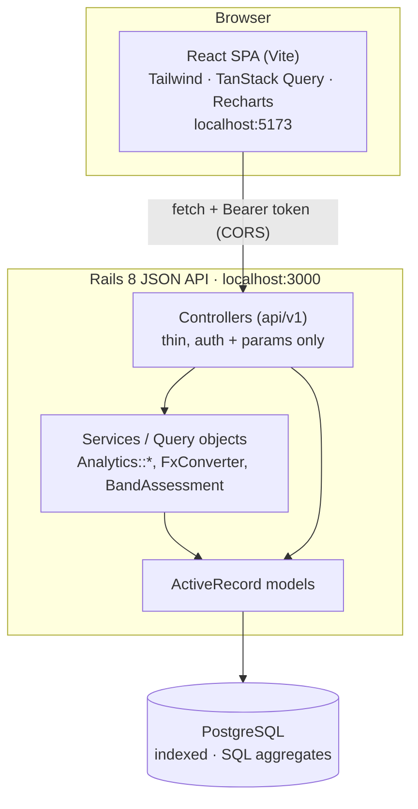
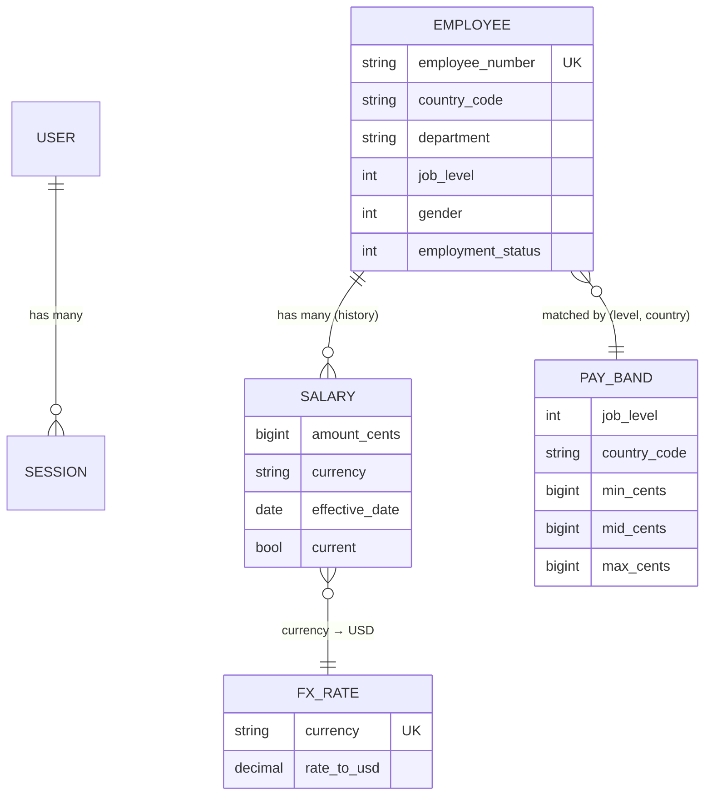

# Architecture

## System shape

Two decoupled applications in one repository, communicating over HTTP/JSON.

Requests carry an opaque bearer token; CORS allows the SPA origin. Controllers stay
thin and delegate all compensation math to plain-Ruby service/query objects, which
push aggregation into SQL.

## Data model

Key modeling choices:

- **Salary history + `current` flag.** Salaries are append-only; exactly one row per
  employee is `current`, enforced by a partial unique index
  (`UNIQUE (employee_id) WHERE current`). Aggregates filter `current = true`.
- **Money as integer minor units + ISO currency.** No floating-point drift.
- **FX normalization** to USD via `fx_rates.rate_to_usd`, joined in SQL for analytics
  and applied by `FxConverter` for single-record display.
- **Pay bands** per `(job_level, country_code)` drive compa-ratio and outlier flags.

## Analytics (computed in SQL)

All KPIs are grouped SQL aggregates over `current` salaries of active employees,
normalized to USD (`salaries.amount_cents * fx_rates.rate_to_usd`):

- **Payroll** — `COUNT`, `SUM`, `AVG`, and true median via
  `PERCENTILE_CONT(0.5) WITHIN GROUP (...)`, plus a `CASE`-bucketed distribution.
- **Breakdown** — the same aggregates grouped by country, department, or job level.
- **Equity** — average compensation grouped by gender, overall and per department,
  reported as a male-vs-female gap percentage.

No analytics path loads 10k rows into Ruby.

## Request flow (example: employee list)

1. `GET /api/v1/employees?q=&country=&page=` → `EmployeesController#index`.
2. `authenticate!` resolves the bearer token to a `Session` → `current_user`.
3. `EmployeesQuery` applies search, whitelisted filters, and a whitelisted sort.
4. `Paginatable` adds `LIMIT/OFFSET` and a count; `current_salary` is eager-loaded.
5. `EmployeeSerializer` renders rows with USD-normalized salary via `FxConverter`.

## Performance

- Indexes on `employees (country_code, department, job_level, employment_status)`
  and the partial `salaries (employee_id) WHERE current` back filters and aggregates.
- The employee list eager-loads `current_salary` (one extra query, no N+1) and is
  paginated.
- Seeding 10k employees + ~20k salary rows uses batched `insert_all` (~7s).
- Analytics are cache-ready (Solid Cache is configured) if endpoints ever need it.

## Security

- Bearer tokens stored only as SHA-256 digests; revocable; TTL-bounded.
- Login uses `authenticate_by` (constant-time) and is rate-limited.
- CORS restricted to the configured frontend origin.
- Strong parameters on all writes; Brakeman clean.

## Known trade-offs

- React Router carries two moderate advisories fixed only in a breaking v7; neither
  applies here (no SSR hydration, no links built from untrusted input), so the
  breaking upgrade is deferred.
- The SPA stores its token in `localStorage` — acceptable for a single-operator
  internal tool; a hardened deployment would prefer httpOnly cookies.
